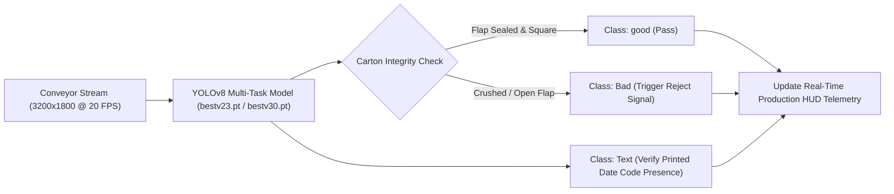

# 📦 High-Speed FMCG Packaging Conveyor & Lot-Code Verification

[](https://ultralytics.com)
[](https://opencv.org)
[]()

> **Real-Time Automated Conveyor Defect Sorting and Expiration Lot-Code Verification for High-Speed Tea Packaging Lines.**

---

## 📌 1. Project Overview

High-speed packaging lines produce thousands of beverage cartons per hour. Dented packages, unsealed top flaps, crushed corners, or unprinted expiration dates cause regulatory non-compliance and expensive batch recalls.

This project deploys a dual-task vision system on live conveyor belts:
1. **Structural Carton Integrity Sorting**: Detects and isolates deformed or unsealed cartons (`Bad`) versus intact cartons (`good`) in $<50\text{ ms}$.
2. **Lot-Code & Expiration Date Localization**: Pinpoints the printed alphanumeric batch window (`Text`) and verification field (`red`).
3. **Multi-SKU Robustness**: Seamlessly inspects yellow label tea, green tea, and herbal infusions across varying background color palettes.


---

## ⚙️ 2. Core Detection Classes & Logic

| Class | Visual Cue | Detection Purpose |
| :--- | :--- | :--- |
| **`good`** | Green Box `(0, 255, 0)` | Structurally sound carton with perfect flap sealing |
| **`Bad`** | Red Box `(0, 0, 255)` | Damaged, torn, open-flap, or crushed carton requiring pneumatic ejection |
| **`Text`** | Blue Box `(255, 0, 0)` | Printed expiration date and manufacturing batch code (`Lot code`) |
| **`red`** | Orange Box `(0, 165, 255)` | Pre-printed date window anchor for spatial alignment |



---

## 🏗️ 3. Directory Structure

```text
LIPTON Tea/
├── part 1/                     # Primary single-stream packaging inspection
│   ├── one.py                  # Full conveyor inspection pipeline
│   ├── test.py                 # Benchmarking script
│   └── bestv23.pt              # Model weights (SKU 1)
├── part 2/                     # Multi-SKU color variant inspection (Green, Red, Orange, Yellow)
│   ├── test.py                 # Multi-color variant test pipeline
│   ├── New Text Document.py    # Alternative inference configurations
│   └── bestv30.pt              # Enhanced multi-SKU model weights
└── README.md                   # System documentation
```

---

## 🚀 4. How to Run

```bash
# Run Part 1 packaging conveyor inspection
cd "part 1"
python one.py

# Run Part 2 multi-SKU variant inspection
cd "../part 2"
python test.py
```
