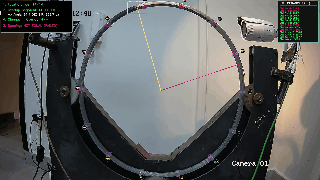
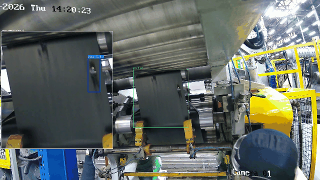
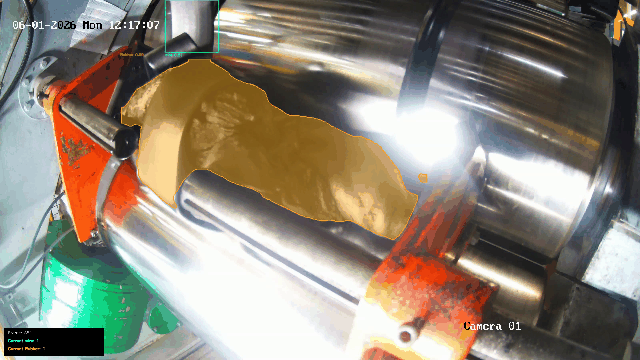
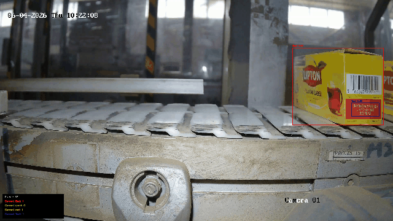

# 🏭 Industrial Edge AI & Computer Vision Quality Inspection Suite
### End-to-End Deep Learning, Optical Metrology & Automated Defect Inspection for Manufacturing Lines

[](https://python.org)
[](https://pytorch.org)
[](https://ultralytics.com)
[](https://opencv.org)
[](LICENSE)

---

## 🌟 Executive Summary

This repository hosts a production-grade suite of **4 computer vision and deep learning systems** designed, trained, and deployed for real-world automated visual quality control (**Automated Optical Inspection - AOI**) across manufacturing plants.

Moving beyond standard benchmark datasets, these systems operate under real factory constraints: **high-speed conveyor belts**, **mirror-like metallic specular reflections**, **extreme optical lens distortion**, and **strict sub-millimeter geometric tolerances**.

```text
📂 Repository Root
├── 📁 Pirelli/       # Circular Tyre Bead Metrology, 14-Clamp Verification & Overlap Analysis
├── 📁 cushion/       # 4K Two-Stage Cascade Pipeline with Optical Camera Calibration
├── 📁 rubber/        # High-Glare Calender Mill Instance Segmentation with 40% Alpha Blending
├── 📁 LIPTON Tea/    # FMCG High-Speed Conveyor Defect Sorting & Automated Date-Code Bounding
└── 📁 assets/        # Visual Demos, Inspection Telemetry & Animated GIF Showcases
```

---

## 📊 Industrial Systems Comparison Matrix

| System | Industrial Target | Core AI / CV Architecture | Video Resolution | Inference FPS | Key Metrology / Defect Target | Sub-Module Link |
| :--- | :--- | :--- | :--- | :--- | :--- | :--- |
| **Pirelli Tyre Metrology** | Automotive & Tyre Manufacturing | YOLOv8 + Polar Coordinate Mapping ($\theta, R$) | **2560x1440 (2K)** | 20.0 FPS | 14 Clamps Spacing ($\pm 15\text{ px}$), Overlap Sector ($\Delta \theta$), Bead Height | [Explore Pirelli System →](./Pirelli/) |
| **Calender Cushion Cascade** | Continuous Rubber Calendering | Pinhole Camera Calibration + 2-Stage Cascade AI | **3840x2160 (4K)** | 12.5 FPS | Lens Undistortion, Micro-folds (`fol`), Material Punctures (`hol`) | [Explore Cushion System →](./cushion/) |
| **Heavy Rubber Mill** | Rubber Compounding & Extrusion | YOLOv8 Instance Segmentation + 40% Alpha Blending | **3200x1800 (3.2K)** | 20.0 FPS | Anti-glare Cord Alignment, Rubber Contours, Steel Wire Feed | [Explore Rubber System →](./rubber/) |
| **FMCG Packaging (Lipton)** | Beverage Packaging Lines | Multi-SKU Conveyor Classifier & Date-Code Bounding | **3200x1800 (3.2K)** | 20.0 FPS | Damaged Cartons (`Bad` $<50\text{ms}$), Lot Code & Expiry Bounding (`Text`) | [Explore Lipton System →](./LIPTON%20Tea/) |

---

## 🔬 Deep Dives & Visual Evidence

### 1️⃣ Pirelli Tyre Manufacturing — Circular Metrology & Clamp Verification



* **Industrial Problem**: Verifying clamp uniformity and overlap angular extent manually on rotating tyre carcasses creates safety risks and operator fatigue.
* **Algorithmic Solution**:
  * Cartesian to **Polar Coordinate Transformation**:
    $$\theta = \text{atan2}(y - Y_c, x - X_c) \times \frac{180}{\pi}, \quad R = \sqrt{(x - X_c)^2 + (y - Y_c)^2}$$
  * Circular Euclidean distance tracking verifying 14 equidistant clamps ($\pm 15\text{ px}$ tolerance).
  * Color-coded real-time HUD alerting operators if any clamp interval violates spacing thresholds.
  * Overlap arc computation between `Head` and `Tail` reference markers.

🔗 **Detailed Sub-Module Documentation**: [`Pirelli/Front/README.md`](./Pirelli/Front/README.md) & [`Pirelli/Head/README.md`](./Pirelli/Head/README.md)

---

### 2️⃣ Industrial Calender Cushion — Two-Stage Cascade Inspection



* **Industrial Problem**: Wide-angle lenses on 4K cameras introduce barrel distortion that misrepresents physical dimensions, while inspecting full 4K frames directly for tiny punctures yields high false negative rates.
* **Algorithmic Solution**:
  * **Optical Calibration**: Inverting lens distortion using camera intrinsics ($K$) and 5-parameter distortion coefficients ($D$) via `cv2.initUndistortRectifyMap` and `cv2.remap`.
  * **Two-Stage Cascade Architecture**: Stage 1 isolates the dynamic moving web (`cou`); Stage 2 runs high-confidence defect diagnosis (`bestv1.11.pt`) on the localized crop.
  * **Operator HUD**: Live 65% scaled Picture-in-Picture (PiP) window displaying zoomed defect regions in real-time.

🔗 **Detailed Sub-Module Documentation**: [`cushion/README.md`](./cushion/README.md)

---

### 3️⃣ Rubber Compounding Mill — Instance Segmentation with Alpha Blending



* **Industrial Problem**: Rotating mirror-like steel cylinders produce severe specular reflections (glare) that wash out standard edge detectors. Operators need to see both the segmentation masks and the raw surface texture simultaneously.
* **Algorithmic Solution**:
  * Fine-tuned **YOLOv8 Instance Segmentation** model isolating raw rubber mass (`Rubber`) and steel reinforcement cords (`wire`).
  * **40% Alpha Blending**:
    $$\text{Frame}_{\text{out}} = 0.40 \times \text{Mask} + 0.60 \times \text{Frame}_{\text{orig}}$$
    Provides instant visual confirmation of cord alignment without occluding underlying defects.

🔗 **Detailed Sub-Module Documentation**: [`rubber/README.md`](./rubber/README.md)

---

### 4️⃣ FMCG High-Speed Packaging (Lipton) — Conveyor Defect Sorting & OCR



* **Industrial Problem**: Defective tea cartons (dented corners, unsealed flaps) or unprinted expiration dates cause regulatory non-compliance and expensive batch recalls.
* **Algorithmic Solution**:
  * Sub-50ms dual-task classification separating intact cartons (`good`) from damaged cartons (`Bad`).
  * Dedicated date-code localization (`Text` and `red`) anchor boxes verifying expiration stamp presence on moving conveyors.
  * Multi-SKU robustness across yellow, green, red, and orange packaging variations.

🔗 **Detailed Sub-Module Documentation**: [`LIPTON Tea/README.md`](./LIPTON%20Tea/README.md)

---

## 🛠️ Tech Stack & Hardware Requirements

* **Language**: Python 3.12+
* **Deep Learning Framework**: PyTorch 2.0+ (CUDA 12.8 enabled)
* **Model Families**: Ultralytics YOLOv8 / YOLOv11 (Object Detection & Instance Segmentation)
* **Computer Vision**: OpenCV 4.13, NumPy, SciPy, Pillow
* **Recommended Hardware**:
  * GPU: NVIDIA RTX 3060 / 4060 or higher (8GB+ VRAM for 4K real-time inference)
  * CPU: Intel Core i7 / AMD Ryzen 7 (16+ Threads for high-throughput video decoding)
  * RAM: 16 GB minimum (32 GB recommended for 4K video buffering)

---

## 🚀 Quickstart & Installation

```bash
# 1. Clone repository
git clone https://github.com/your-username/Industrial-Computer-Vision-Quality-Inspection-Suite.git
cd Industrial-Computer-Vision-Quality-Inspection-Suite

# 2. Create and activate virtual environment
python -m venv venv
# Windows:
venv\Scripts\activate
# Linux/macOS:
source venv/bin/activate

# 3. Install dependencies
pip install -r requirements.txt

# 4. Run any inspection pipeline
# Example: Run Pirelli Metrology System
cd Pirelli/Front
python "test - Copy.py"

# Example: Run Cushion Two-Stage Cascade System
cd ../../cushion
python allcode.py
```

---

## 📄 License & Attribution

This project is licensed under the MIT License - see the [LICENSE](LICENSE) file for details.  
Industrial inspection data, calibration benchmarks, and model architectures developed for industrial manufacturing quality control.
